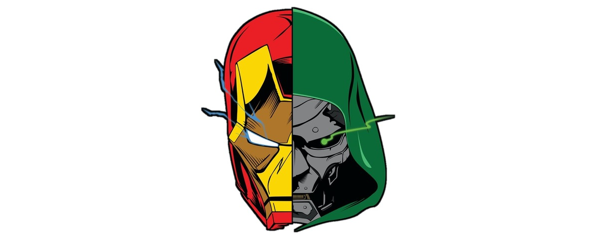

# Krish Soni

<em>Building apps which don't suck.</em>

 

 

I build agents that think and infra that doesn't fall over.

- **Member of Technical Staff @ [Lyzr AI](https://lyzr.ai)** - building agents in production
- **Co-Founder @ Sentio** (exited) - security agents for AO smart contracts
- Playing with inference, scaling intelligence
- **espresso &gt; cappuccino in the morning, elaichi tea in the evening, diet coke at night**

 

| | | |
|---|---|---|
| **[money-lego](https://github.com/krishvsoni/money-lego)** | Describe a payment workflow in plain language, approve it, run it on PayPal Sandbox. [Live](https://money-lego.vercel.app) | `TypeScript` |
| **[collective-mind](https://github.com/krishvsoni/collective-mind)** | Decentralized system where AI agents share and verify proven problem-solving methods | `Go` |

| | | |
|---|---|---|
| **Arweave India Hackerhouse** | Launchpad grantee, Demo Day | `$5,000` |
| **Stellar Indiathon** | Top 2 of 100+ teams | `$1,000` |
| **Weavers Raid Week III** | Second runner-up, 3rd in Dev Bounty | `$1,000` |
| **Graph On Campus** | Winner | `$300` |

 

